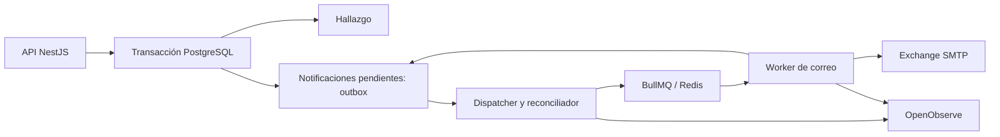

# Propuesta de correos confiables para ComportArte

Fecha: 5 de noviembre de 2026. Estado: implementación preparada en local; infraestructura del VPS instalada. Activación de la nueva API y del worker pendiente del commit y push de Eduardo.

La operación y las decisiones finales están en [operacion-correos.md](operacion-correos.md). El diseño siguiente conserva el contexto de la propuesta original; la implementación congela HTML y adjuntos antes del commit, cifra el contenido y usa PostgreSQL como registro duradero.

## Decisión recomendada

Implementar un outbox transaccional en PostgreSQL, BullMQ sobre Redis y un worker NestJS independiente. Mantener OpenObserve para logs, métricas y alertas. Kafka es viable, pero añadirlo exclusivamente para los correos introduce más operación y no elimina la necesidad del outbox, del control SMTP ni de los reintentos de negocio.

Alternativa con menos infraestructura: consumir directamente la tabla PostgreSQL con `FOR UPDATE SKIP LOCKED`, reservas temporales y reintentos persistidos. También es una solución profesional para esta carga. La variante BullMQ facilita programación de trabajos y gestión de concurrencia; PostgreSQL sigue siendo el registro duradero que permite reconstruir la cola.

No se midieron volumen diario normal, picos, tamaño medio de adjuntos ni latencia objetivo. La elección es una recomendación basada en el código y el incidente observado; requiere validación de carga antes del despliegue.

## Evidencia revisada

- `package.json`: NestJS 12, TypeORM, PostgreSQL, Nodemailer, MailerModule, ScheduleModule y OpenTelemetry. Sin dependencia directa de Kafka o BullMQ.
- `src/evidences/evidences.service.ts`: creación, cierre, cancelación, inicio de proceso y reasignación disparan notificaciones después de guardar. Varias usan `void`; no hay registro persistente del trabajo pendiente en ese flujo.
- `sendEmailUsers()` recorre destinatarios secuencialmente, registra errores y continúa. Varias peticiones pueden ejecutar estos recorridos simultáneamente; no existe un límite global por cuenta SMTP.
- `notifyByEmail()`: al cerrar, la planta 3 conserva su lista de usuarios; otras plantas notifican al creador. Reasignación une responsables anteriores y nuevos. Conservar estas reglas y consolidar destinatarios del mismo evento.
- `src/mail/mail.service.ts`: `sendCreate()` captura el rechazo SMTP y devuelve éxito al llamador. Un worker que reutilice este método sin corregirlo marcaría trabajos fallidos como completados.
- Las plantillas usan información del hallazgo, usuarios y archivos locales en `public/static/images/evidences`. `sendReassign()` calcula la fecha con `new Date()`; en un reintento debe mostrar la fecha del evento, no la del envío.
- `RequestContextService` depende de AsyncLocalStorage de una petición HTTP. El worker debe recibir los datos del actor explícitamente; no puede depender del contexto HTTP.
- `src/auth/auth.service.ts`: recuperación espera SMTP y oculta el error en la respuesta. `src/auth/jwt.service.ts`: el token caduca en 5 minutos.
- `src/app.module.ts`: PostgreSQL con migraciones automáticas al arrancar. Un worker separado debe desactivar esas migraciones; un único paso de despliegue las ejecutará antes de iniciar procesos.
- `ecosystem.config.js`: API en PM2, una instancia fork. El worker puede tener su propia aplicación PM2 y compartir la versión publicada y los archivos locales.
- `docker-compose.yaml` local: PostgreSQL de desarrollo; no es una descripción del despliegue productivo actual.
- `/home/eduardo/openobserve/docker-compose.yml`: OpenObserve y OTel Collector, persistencia local y rotación de logs del collector. Usar ese estilo operativo, con un proyecto Compose separado para mensajería.
- Lectura puntual del VPS: 4 CPU, 15 GiB RAM, aproximadamente 12 GiB disponibles y 153 GiB libres en disco. No representa una medición de picos ni una reserva garantizada.
- Incidente revisado: 113 intentos fallidos por cuota de almacenamiento del remitente. La cola conserva el trabajo mientras se corrige Exchange; no libera espacio en el buzón.

## Arquitectura propuesta



1. La API valida la operación y determina los destinatarios y el contenido del evento.
2. La misma transacción guarda el cambio del hallazgo y una notificación por destinatario. Todos los repositorios involucrados usan el mismo EntityManager. Si no se puede registrar la notificación, tampoco se confirma la operación.
3. Tras el commit, la API responde sin esperar a SMTP o Redis.
4. El dispatcher publica identificadores de notificaciones elegibles. Si Redis falla, las filas permanecen pendientes y se recuperan después.
5. El worker reclama la notificación mediante una reserva temporal en PostgreSQL, obtiene el permiso de envío de la cuenta y llama al proveedor fuera de la transacción de reserva.
6. Registra aceptación, rechazo, próxima ejecución o necesidad de intervención. Las actualizaciones comprueban el identificador de la reserva para impedir que un worker antiguo cierre trabajo de otro.
7. El reconciliador recupera reservas vencidas y trabajos pendientes ausentes de Redis. No basta con marcar una fila como publicada: Redis podría perderla después.

BullMQ ofrece la ejecución; PostgreSQL conserva el estado y la fecha autorizada de próximo intento. El worker verifica ambos antes de enviar. Evitar dos políticas independientes de reintentos que puedan multiplicar los intentos. Una opción es que el scheduler publique cada intento vencido y BullMQ solo gestione la ejecución y recuperación de trabajos interrumpidos.

## Modelo de datos

Tabla `email_notifications`:

- `id` UUID y `event_id` UUID generado para cada operación confirmada.
- `type`, `evidence_id`, `plant_id`, `actor_id`, `recipient_user_id`, `recipient_email`, `provider_account`.
- `payload_version`, `template_version` y snapshot JSON del contenido necesario para renderizar el evento.
- `attachment_refs`: referencias a archivos inmutables; no incluir binarios en Redis/Kafka.
- `status`: `pending`, `sending`, `retry_wait`, `blocked`, `accepted`, `dead`, `expired`, `cancelled`, `uncertain`.
- `attempt_count`, `next_attempt_at`, `expires_at`, `locked_until`, `lease_token`, `last_error_code`, `last_error_category`, `provider_message_id` y fechas de auditoría.

Restricción única `(event_id, recipient_email_normalized, channel)`, con canal email. Un nuevo evento de reasignación debe generar nuevas notificaciones aunque conserve hallazgo y destinatario. La idempotencia HTTP existente debe devolver la misma operación, sin generar otro evento.

Tabla `email_attempts`: intento, tiempos, resultado, código SMTP y diagnóstico resumido. Tabla o registro compartido `email_provider_state`: pausa por cuenta, razón, próxima comprobación y estado del circuito. Índices parciales sobre trabajos elegibles y reservas vencidas. Fechas operativas con `timestamptz` en UTC; mantener las reglas de hora de planta al construir el snapshot.

No conservar contraseñas, cookies, tokens SMTP o tokens de recuperación en logs. Proteger el contenido sensible almacenado, limitar permisos y definir retención. Propuesta inicial: 30 días de diagnósticos y 90 días de metadatos, sujetos a necesidades de auditoría.

## Política de entrega y reintentos

Valores iniciales propuestos, ajustables tras medir:

| Situación | Acción |
|---|---|
| Conexión rechazada, DNS temporal, SMTP 421/450/451/452 | Hasta 8 intentos totales: inicial y esperas de 1, 5, 15, 30, 60, 120 y 240 minutos, con jitter. Ventana máxima de 24 horas para hallazgos. |
| Throttling del proveedor | Respetar señales de espera y reducir el ritmo de la cuenta; aplazar sin ocupar conexiones ni bloquear el proceso con sleeps largos. |
| Caso observado: cuota del remitente en `STOREDRV.Submission` | Abrir circuito de esa cuenta, preservar pendientes en `blocked` y alertar una vez por incidente. Intervención y prueba controlada antes de drenar la cola. |
| Cuota de un destinatario durante entrega | Afectar solo esa notificación; aplicar una política específica de aplazamiento/revisión, sin detener toda la cuenta. |
| SMTP 535, falta de permisos o configuración inválida | Pausar cuenta y requerir corrección. No repetir todos los mensajes. |
| Destinatario inexistente, por ejemplo SMTP 550 5.1.1 | Marcar `dead`, corregir destinatario y permitir reenvío auditado. |
| Plantilla inválida o archivo ausente | Marcar para intervención. No ocultar el error ni asumir fallo de red. |
| Timeout tras entregar DATA o caída antes de persistir aceptación | Resultado `uncertain`; hay riesgo de duplicado. Consultar trazabilidad del proveedor o aplicar política explícita de reintento con ese riesgo. |
| Límite de intentos o caducidad | `dead` o `expired`, alerta agregada y revisión. Nunca borrar silenciosamente. |

Clasificar usando `code`, `responseCode`, `command` y respuesta SMTP de Nodemailer, además del código ampliado de Exchange. Un `554` no describe por sí solo la causa. Conservar diagnóstico resumido y evitar depender únicamente de coincidencias de texto.

Iniciar con una conexión SMTP por cuenta y separación mínima de 3 segundos entre inicios de envío, con límite global compartido por todos los workers y margen para otras aplicaciones que usen el buzón. Microsoft documenta 30 mensajes/minuto y hasta 3 conexiones simultáneas para SMTP AUTH. No aumentar workers para superar ese límite. Los intentos también participan del control de ritmo.

## Garantías y límites

- Atomicidad entre el cambio del hallazgo y la intención de notificar.
- Recuperación después de reinicios de API, worker o Redis, mientras PostgreSQL y los adjuntos duraderos se conserven.
- Deduplicación de creación y ejecución normal usando claves únicas y reservas.
- SMTP no participa en una transacción con PostgreSQL/Kafka. Si el proveedor acepta y el worker cae antes de registrarlo, puede haber duplicados. Un Message-ID estable ayuda a rastrear, pero no obliga al destinatario a deduplicar.
- `accepted` significa aceptado por SMTP; no prueba llegada a bandeja de entrada. Confirmar entrega requiere trazas o eventos del proveedor, si están disponibles.
- Un solo VPS sigue siendo un punto de falla. Backups fuera del servidor y restauraciones probadas son necesarios para recuperación; alta disponibilidad requiere infraestructura adicional.

## Contenido, adjuntos y recuperación de contraseña

Guardar un snapshot versionado del evento y sus destinatarios. Leer solo el hallazgo actual al reintentar podría enviar información distinta a la que generó la notificación. Preservar adjuntos referenciados mientras haya notificaciones pendientes; si el worker está en Docker, montar esos archivos como solo lectura. Una copia inmutable por evento u object storage son opciones a evaluar.

Separar recuperación de contraseña por prioridad y caducidad, compartiendo el límite global de la cuenta SMTP. No usar la ventana de 24 horas de hallazgos para tokens de cinco minutos. Propuesta: solicitud persistida con caducidad corta, validación de cuenta y generación de token al primer intento elegible; no emitir tokens nuevos indefinidamente al reintentar. Cancelar solicitudes reemplazadas o inválidas y mantener la respuesta genérica actual. Definir y probar explícitamente la interacción entre el vencimiento de la solicitud, el token y cualquier reenvío.

## Despliegue en el VPS

Mantener `/home/eduardo/openobserve` como proyecto de observabilidad. Crear un proyecto independiente, por ejemplo `/home/eduardo/comportarte-messaging/docker-compose.yml`:

- Redis con versión/digest fijado, volumen persistente, AOF habilitado, política `noeviction`, healthcheck, reinicio, límites de recursos y logs rotados.
- Si API/worker siguen en PM2, publicar Redis exclusivamente en `127.0.0.1`; si están en Docker, usar red privada sin publicación pública. Credenciales fuera del compose y permisos restringidos.
- El AOF con fsync cada segundo conserva una ventana de pérdida ante caída; el reconciliador desde PostgreSQL debe reconstruir trabajos faltantes. Redis no es la única fuente del trabajo pendiente.
- Worker PM2 separado (`mail-worker`), bootstrap NestJS sin servidor HTTP y módulos mínimos. No importar AppModule entero si dispara schedulers, migraciones o servicios HTTP innecesarios.
- Apagado ordenado: dejar de tomar trabajo, esperar envíos activos con timeout y cerrar transportador y conexiones. Reservas expirables para caídas abruptas.
- Presupuesto inicial orientativo: Redis hasta 512 MiB y worker hasta 512 MiB; validar RSS, adjuntos grandes, CPU y memoria bajo carga. Son presupuestos propuestos, no mediciones.
- Un único paso de migraciones, luego API/dispatcher y worker con esquemas compatibles. Asegurar que ambos usan la misma versión de plantillas y acceso a adjuntos.

No mezclar el ciclo de despliegue de Kafka/Redis con el de OpenObserve solo por compartir Docker Compose.

## Variante si se decide usar Kafka

```text
API -> transacción PostgreSQL (hallazgo + outbox)
    -> relay de outbox -> topic comportarte.email.requested.v1
    -> consumer -> registro duradero de notificación -> scheduler/worker -> SMTP
                                                        -> OpenObserve
```

El relay reintenta publicar; publicación y marcado del outbox pueden duplicarse, por lo que el consumer inserta usando una clave única. Confirmar offsets solo después de persistir el trabajo recibido. El scheduler guarda `next_attempt_at` en PostgreSQL y programa los intentos; no mantener una partición detenida durante horas por una cuota SMTP. Una DLQ lógica en PostgreSQL puede complementarse con un topic `comportarte.email.dead.v1`.

Kafka transportaría identificadores y metadatos mínimos; PostgreSQL mantendría el contenido y el estado por destinatario. Clave de partición por hallazgo si se requiere orden de eventos; eso no garantiza orden de entrega tras reintentos. Definir explícitamente si un evento posterior puede enviarse antes de uno pendiente. El replay de Kafka no debe reenviar automáticamente notificaciones ya aceptadas o expiradas.

Para piloto en un VPS: un nodo KRaft, volumen persistente, listeners internos y acceso del host solo por loopback, healthcheck, límites de memoria/disco, retención finita y logs rotados. Replication factor 1: sin redundancia. Productor idempotente y `acks=all` ayudan al transporte, pero un solo broker no ofrece tolerancia a la pérdida del nodo.

Para alta disponibilidad: brokers y quorum de controladores repartidos en dominios de falla independientes; una configuración habitual es tres brokers, factor de replicación 3, `min.insync.replicas=2`, `acks=all` y tres controladores. Varios contenedores en el mismo VPS no protegen ante su caída. Apache desaconseja roles combinados broker/controller para despliegues críticos.

Kafka tiene más sentido si el mismo evento también alimentará auditoría, integraciones, analítica u otros servicios independientes con necesidad de replay. Para el objetivo actual, PostgreSQL + BullMQ ofrece una operación más sencilla. En ambas variantes la confiabilidad depende del outbox, del worker y de las políticas de entrega.

## OpenObserve y operación

Stream propuesto `mail_comportarte`, o registros estructurados en el stream existente con `component=mail-worker`. Campos: `notification_id`, `event_id`, `evidence_id`, `plant_id`, `type`, `attempt`, `result`, `error_category`, `smtp_code`, `duration_ms`, `queue_age_ms`, `provider_account`, `trace_id`. Evitar direcciones completas en logs por defecto.

Panel: pendientes, antigüedad del más antiguo, aceptados/minuto, reintentos, bloqueados por cuenta, dead letters, errores por categoría, heartbeat de worker/dispatcher y diferencia entre trabajo elegible en PostgreSQL y cola activa. Emitir métricas periódicas derivadas del estado duradero: no depender solo de contar logs.

Alertas propuestas: cuenta pausada inmediatamente, worker sin heartbeat por 2 minutos, trabajo elegible sin progreso por 5 minutos, cualquier dead letter nuevo y crecimiento de backlog. Ajustar antigüedad para pausas conocidas y volumen esperado. Enviar recuperación al cerrar el incidente. Telegram debe agrupar por cuenta/causa y mostrar cantidad afectada; un silencio de 30 minutos no equivale a recuperación.

## Plan de implementación y validación

1. Resolver cuota del remitente; confirmar el estado actual antes de recuperar correos históricos.
2. Agregar entidades/migraciones, repositorios transaccionales y un constructor de notificaciones que consolide destinatarios y capture snapshots.
3. Adaptar creación, cierre, inicio, cancelación y reasignación para guardar hallazgo y outbox juntos; preservar permisos, concurrencia, idempotencia HTTP y reglas por planta.
4. Separar render/transporte de la política de errores. Propagar el rechazo de `sendCreate()` y devolver información de aceptación del proveedor.
5. Implementar worker, reservas, dispatcher, reconciliador, pausas por cuenta, caducidad y reenvío auditado. Incorporar recuperación de contraseña con su política específica.
6. Probar con SMTP controlado: fallo antes/después de commit, Redis caído, reinicio de worker, reserva vencida, caída después de aceptación, throttling, cuota, destinatario inválido, adjunto ausente, token vencido y dos workers compitiendo.
7. Validar que un retry HTTP no duplica el evento, que destinatarios repetidos reciben una sola notificación por evento y que la recuperación de Redis conserva pendientes. Probar también restauración y carga con adjuntos reales anonimizados.
8. Desplegar desactivado para envío real, revisar trabajos en un entorno de prueba y activar por etapas. No ejecutar envío directo y cola para la misma operación.
9. Recuperar los intentos del incidente como una operación separada: verificar vigencia, destinatarios, contenido y posibles envíos posteriores antes de reenviar. Los logs permiten identificar fallos, pero no contienen por sí solos un outbox histórico completo.

Rollback: pausar worker/dispatcher y conservar las tablas. Volver a envío directo solo con un corte explícito que evite procesar el mismo evento por ambas vías; un rollback no debe borrar pendientes.

## Fuentes técnicas

- Kafka, semántica de entrega y sistemas externos: https://kafka.apache.org/design/
- Kafka KRaft y despliegue: https://kafka.apache.org/44/operations/kraft/
- BullMQ, trabajos idempotentes: https://docs.bullmq.io/patterns/idempotent-jobs
- BullMQ, reintentos: https://docs.bullmq.io/guide/retrying-failing-jobs
- BullMQ, identificadores y límites de deduplicación: https://docs.bullmq.io/guide/jobs/job-ids
- PostgreSQL, SKIP LOCKED para consumidores de colas: https://www.postgresql.org/docs/current/sql-select.htm
- Exchange, almacenamiento y concurrencia SMTP: https://learn.microsoft.com/en-us/troubleshoot/exchange/send-emails/smtp-submission-improvements
- Exchange, límites de salida: https://learn.microsoft.com/en-us/defender-office-365/outbound-spam-sending-limits-troubleshoot
